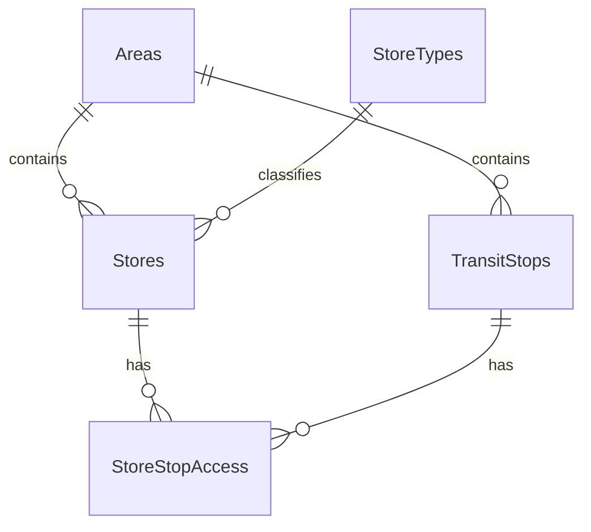

# FoodMap — final project design

CSCI 3304 · Data for Breaking Barriers · Alexis Roel and Corey Poole

## Purpose

FoodMap uses a relational database to examine geographic, transportation and economic barriers to affordable healthy food. The results support screening for potential store, pantry or transit interventions rather than making causal claims.

## Entity-relationship model

Areas: area_id PK; zip_code, county, population, median_income, poverty_rate, pct_households_no_vehicle.
StoreTypes: type_id PK; type_name UNIQUE; sells_fresh_produce.
Stores: store_id PK; name, address, latitude, longitude, accepts_snap; area_id FK; type_id FK.
TransitStops: stop_id PK; stop_name, latitude, longitude; area_id FK.
StoreStopAccess: store_id FK, stop_id FK (composite PK); walk_distance_m.

Each table stores one type of entity or relationship. In the intended model, nonkey attributes depend on the whole key, not another nonkey attribute. Store type information is stored once, and walking distance depends on both store and stop. Area ZIP is not a unique key. The bridge resolves the many-to-many relationship. Foreign keys and checks enforce referential integrity and valid numeric ranges.

## Requirements and verification

| Proposal feature | Implementation | Verification |
|---|---|---|
| Five tables and relationships | schema.sql | schema / foreign key checks |
| Stores and Areas CRUD | crud.py, Manage Data | automated CRUD and validation tests |
| Q1: low income and low fresh-store density | Query 1 | expected fixture results |
| Q2: high no-vehicle rate and no walkable produce store | Query 2 | expected fixture results |
| Q3: SNAP stores near transit by ZIP | Query 3 | expected fixture and injection tests |
| Q4: county store mix | Query 4 | expected fixture results |
| Q5: top N gap scores | Query 5 | expected fixture results |
| Extra credit | Map & Charts | Streamlit smoke test defined |
| Public-source ingestion | import_real_data.py | offline input-format fixture test; live sources not yet executed |

## Access-gap score

Default score = 0.4 × poverty percentage + 0.3 × households without vehicles percentage + 0.3 × 100 × max(0, 1 − fresh stores per 10,000 / 4). Higher scores indicate larger estimated gaps. Weights and reference density can be changed. A score is not an official food-desert designation.

## Demonstration sequence

1. Start the app and identify the data mode.
2. Browse the five tables. Create an area, add a store, edit its coordinates (walking links recalculate), delete the store and the now-unreferenced area.
3. Run all five analytical queries with their default inputs; adjust at least one parameter and inspect the SQL expander.
4. Show the store map, food-desert candidate map and access-gap bar chart.
5. Explain source dates, proxy fresh-produce classification, approximate walking distance and the ZIP geography limitation.
6. Run the test suite and show the result. Use real-data mode for real-world conclusions; never present synthetic output as actual findings.
